<div align="center">


# Homelab Status

**One live page for your whole home lab: every machine, container, service and backup.**
It has maps with traffic moving between your devices, a wall-screen mode for a spare monitor, one-click updates,
and failover that keeps the page up when a server goes down.

No database, no agents to install, no npm packages. One `node server.mjs`.

[**Try the demo**](#try-it-in-30-seconds) · [**Set it up with your AI**](#set-it-up-with-your-ai) · [What you get](#what-you-get) · [How it works](#how-it-works) · [Security](#security)


<picture>
  <source media="(prefers-color-scheme: light)" srcset="docs/images/overview-light.webp">
  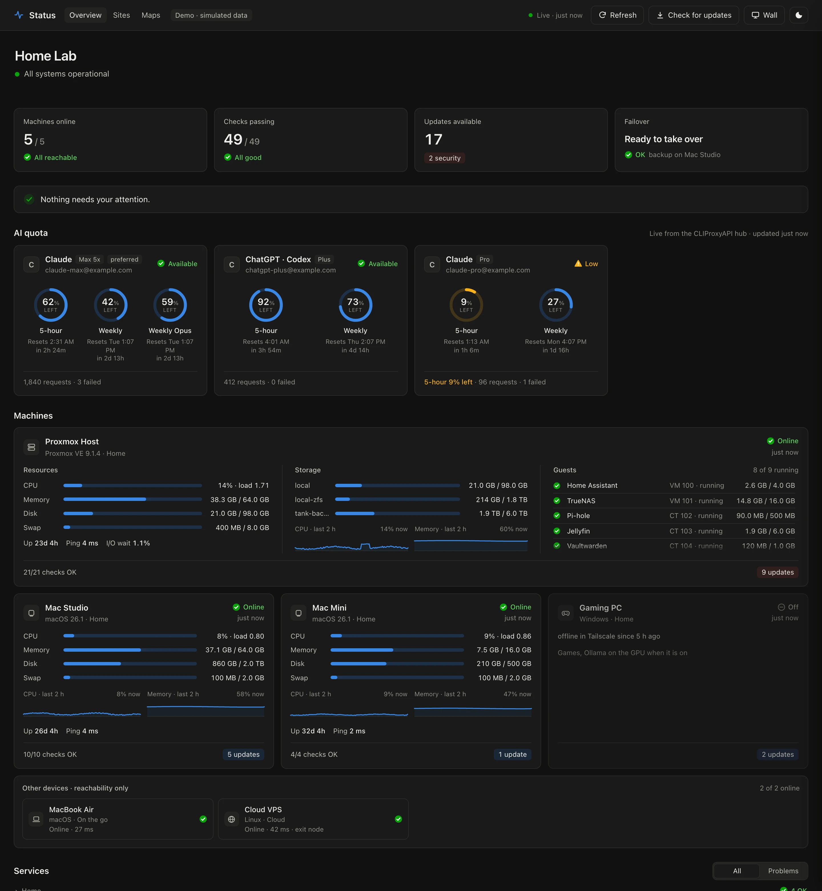
</picture>

</div>

## Try it in 30 seconds

```bash
git clone https://github.com/YasushikoX/homelab-status && cd homelab-status
node server.mjs --demo
```

Open **http://localhost:3900**. It's a fictional home lab with live simulated data: a Proxmox host with nine guests, a Mac Studio running local AI, a Mac Mini, a Raspberry Pi at the parents' house, a gaming PC and a VPS.
Something breaks every few minutes, so you can watch problems appear, alerts queue up and the maps light up red.
Try **/wall** for the always-on screen, and **Maps → Services → Impact** to see what depends on what.

<sub>Needs only Node.js 22 or newer. The demo contacts nothing and changes nothing.</sub>

## Set it up with your AI

You don't fill in config files by hand. Paste this into Claude Code, Codex, Cursor, or any coding agent that can run commands on your machine:

```text
Set up Homelab Status for my home lab: https://github.com/YasushikoX/homelab-status
Clone it, read docs/SETUP.md and follow it step by step. Discover my machines and
services yourself, ask me only what you can't find out, and check with me before
you install or change anything on a machine.
```

The agent follows [`docs/SETUP.md`](docs/SETUP.md), a playbook written for agents:

1. **Shows you the demo**, so you know what you're getting.
2. **Discovers your lab, read-only.** It reads your Tailscale peers, and over SSH it finds Proxmox guests, Docker containers, systemd units, launchd jobs and listening ports.
3. **Asks a few questions:** which box should host the dashboard, which services matter, and whether you want alerts or a backup copy.
4. **Writes your config and draws your maps:** `config.mjs`, `instance.json` and `maps.mjs`, laid out for *your* network.
5. **Installs it**, after showing you each step: a systemd or launchd service, an SSH key with access to read your machines, and `tailscale serve`.
6. **Verifies everything:** every machine reporting and every check green. Then it hands you the URL.

Your setup stays yours. `config.mjs`, `maps.mjs` and `instance.json` are git-ignored, and secrets are read only on the machine that holds them.
Prefer doing it by hand? `docs/SETUP.md` reads fine for humans too.

## What you get

### Problems first, everything else a glance away
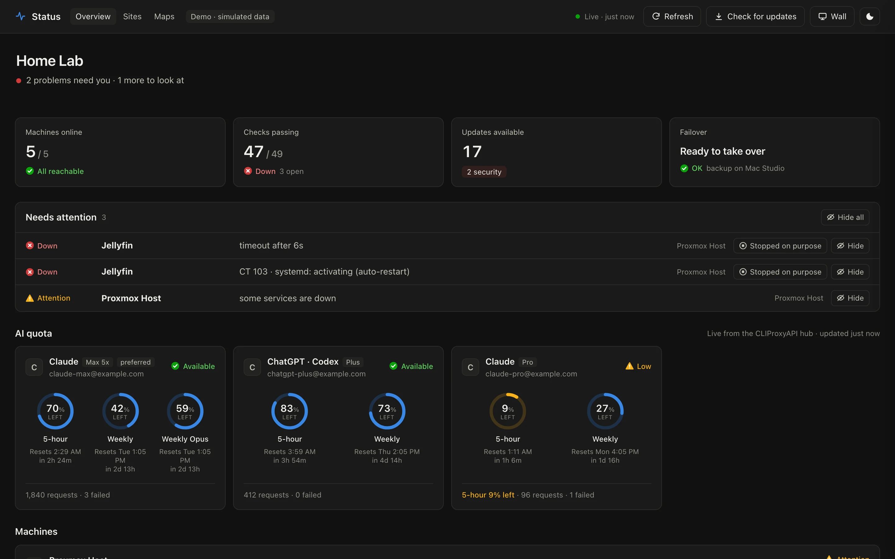

If something is wrong, it's at the top in plain words: what, where, and the detail you'd look up anyway.
**Hide** an item until it changes. Mark something you switched off as **Stopped on purpose**: it turns grey and stops alerting, and the mark clears itself once it's running again.

### Every machine, down to the container
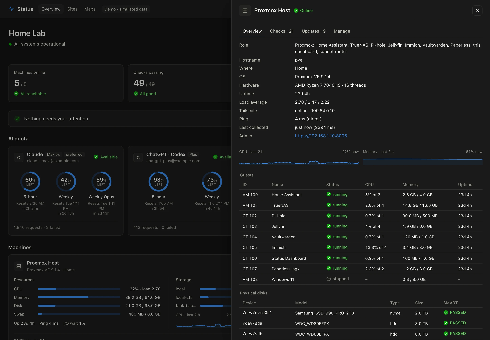

- **Stats for each machine:** CPU, memory, disks, swap, I/O wait, and two-hour charts.
- **Proxmox in depth:** every guest, storage pool, SMART health, and whether vzdump jobs actually ran.
- **Services on each machine:** systemd units, Docker containers, launchd jobs, local ports, and "did last night's backup write its file".
- **Updates:** apt, Homebrew, macOS, winget and Windows Update in one list. App versions are compared with their latest GitHub or npm releases.
- **One-click actions:** upgrades, restarts, guest power and a web terminal. Risky actions make you type the machine's name first, and logs stream live.

### Maps that are alive
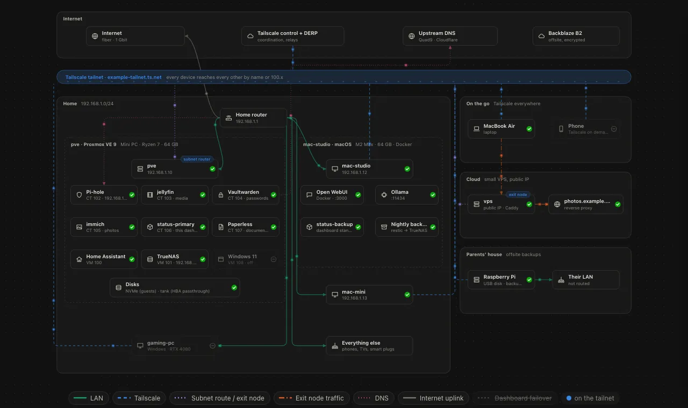

Three hand-drawn maps, coloured live by the same checks as the dashboard:
- **Network:** devices, LANs, the tailnet, subnet routes, exit nodes and DNS.
- **Services:** what runs where and what calls what.
- **Data & backups:** where your data lives, which job copies it, and where the copies land. Gaps are flagged.

Packets move along the links. Hover a node to light up its connections.

| Services map + **Impact**: pick TrueNAS and see the 8 things that stop working | Data & backups: copies, offsite targets and flagged gaps |
|---|---|
| 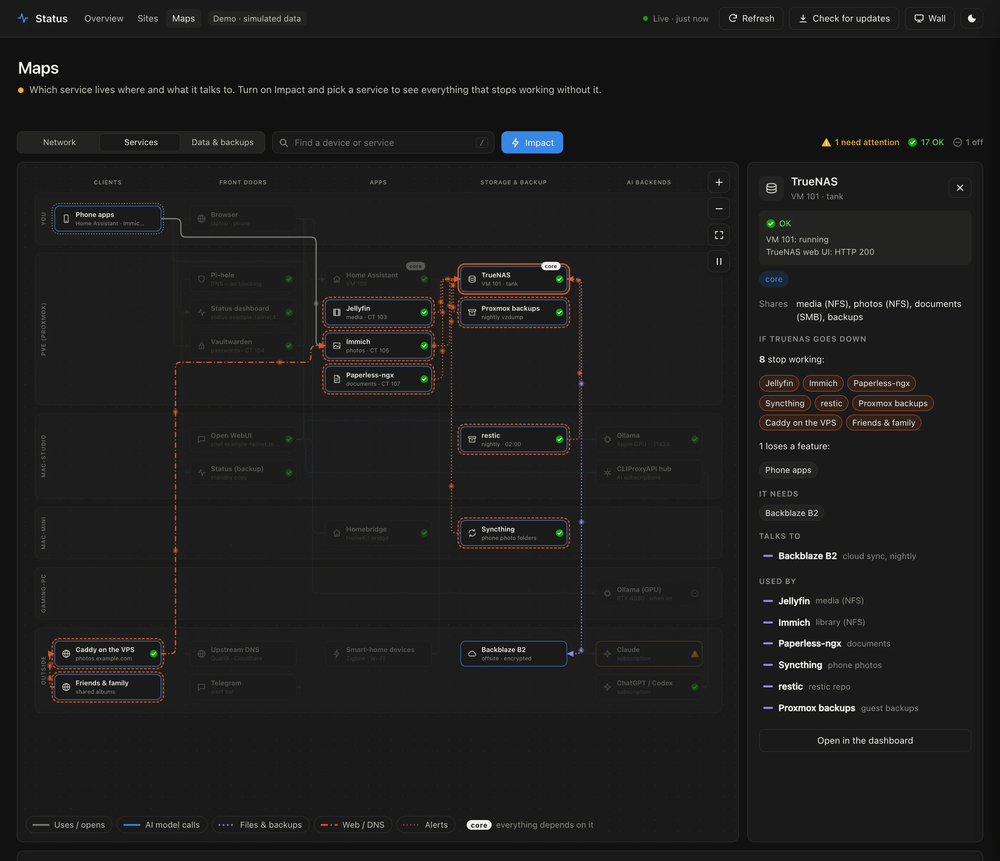 | 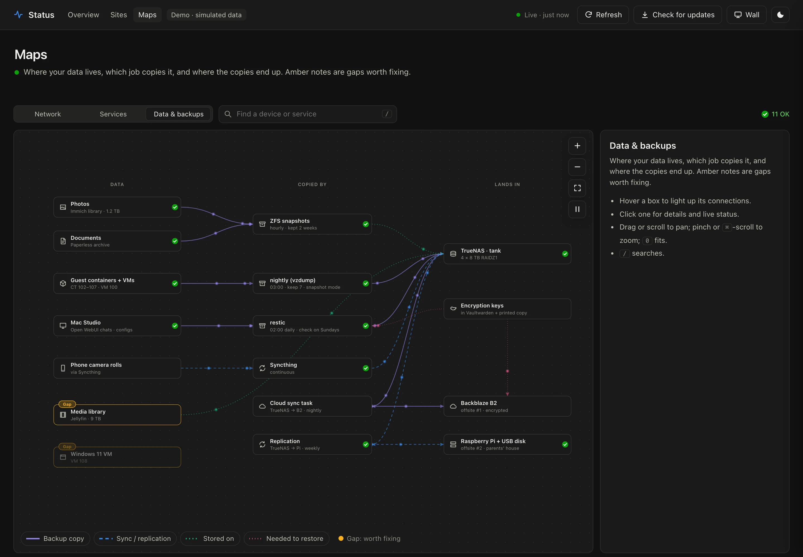 |

### A wall screen for that spare monitor
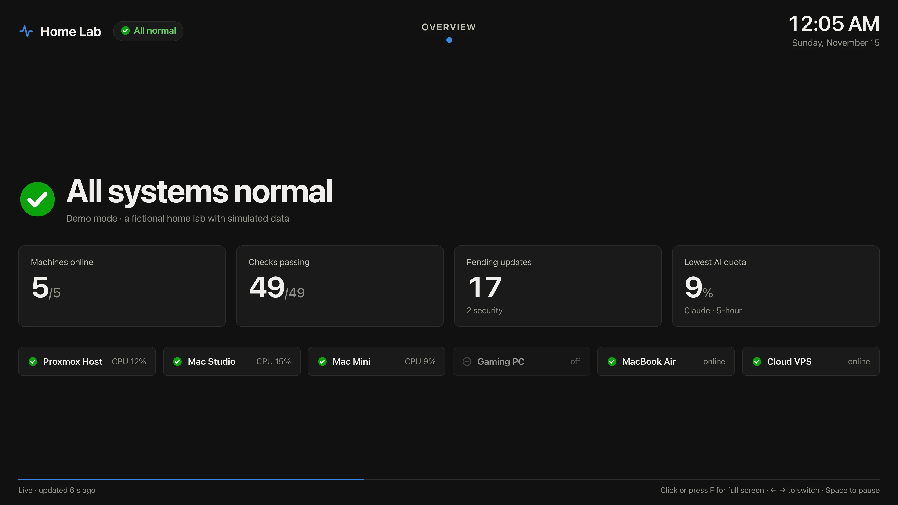

`/wall` rotates through the overview, machines, Proxmox guests, services, AI quota, the three maps (with a slow camera tour), recent activity and updates.
When something breaks it **takes over the screen**:

| Machines | Something is down |
|---|---|
| 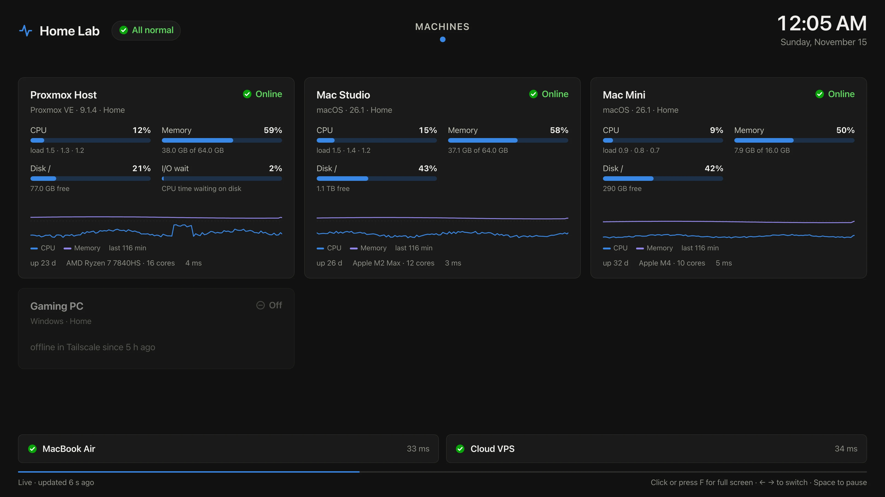 | 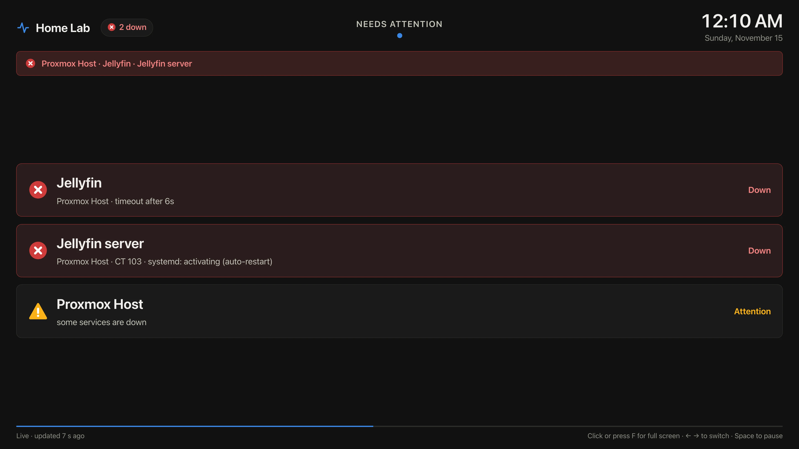 |

It's built to stay on for months:
- It keeps the display awake and hides the cursor.
- It shifts by a few pixels to prevent burn-in, and dims at night.
- It reconnects quietly, and reloads itself when you deploy a new version.

### Alerts that don't cry wolf
- **Telegram, or any script** (ntfy, Pushover, a Slack webhook…).
- **Only real outages:** something has to stay down for a few minutes before you hear about it.
- **One message for flapping:** a service that bounces counts as the same outage, and the recovery is announced only once it holds.
- **Your internet vs. your services:** when the home connection itself is wobbling, service alerts are held and you get one "internet looks unstable" message instead of twenty.
- **Quiet windows** for known blips, like a router that restarts every night.

### Failover, so it's there when you need it most
Optionally run two copies, for example a Proxmox container and a Mac.
Both collect all the time, and only the active one answers at `https://status.<your-tailnet>.ts.net`, using a [Tailscale Service](https://tailscale.com/kb/1552/tailscale-services).
If the primary stops answering on both the tailnet and the LAN, the backup takes over within about a minute and hands back when the primary is healthy.
Things you hid or marked as stopped are carried over, so the backup doesn't alert on them.

### Also
- **Sites:** a launcher page for every web UI in your lab, each with a live status dot.
- **AI quota:** if you pool Claude, ChatGPT or Kimi subscriptions behind [CLIProxyAPI](https://github.com/router-for-me/CLIProxyAPI), see what's left in each window. It's optional and hidden when unused.
- **Phone friendly:** works as a home-screen web app.

  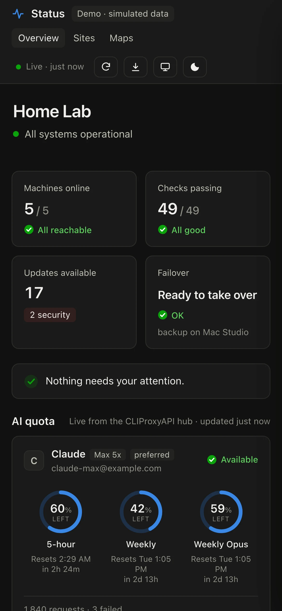

- **Light and dark themes**, readable at a glance, with colours that never carry meaning alone.

## How it works

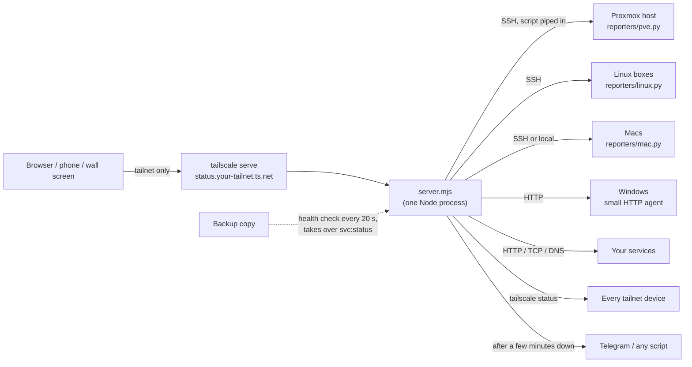

- **Agentless.** The reporters are single-file Python scripts (standard library only). Each run, the server pipes one over SSH to the machine. Nothing is installed on your machines and nothing listens there.
- **Zero dependencies.** About 6,800 lines of plain JavaScript, CSS and Python, with no build step and no `node_modules`. State is one JSON file.
- **Polls only as hard as it needs to.** It checks every 30 seconds while someone is looking, every few minutes when nobody is, and in between for a wall screen.
- **Your inventory is code.** `config.mjs` describes your machines, checks and the exact commands each button may run. The browser can only pick from that list.

What it can read:

| Source | What you get |
|---|---|
| **Proxmox VE** (`pve.py`, as root) | Host stats, every guest (CPU, memory, IP, start at boot), storage pools, SMART, vzdump jobs and their last run, systemd units and Docker inside containers, apt updates for the host and every container |
| **Linux** (`linux.py`) | Stats, CPU temperature, systemd units, Docker, local ports, file freshness, apt updates |
| **macOS** (`mac.py`) | Stats, memory pressure, battery and thermal throttling, launchd jobs, Docker, local ports, processes, Homebrew and macOS updates |
| **Windows** | Any small HTTP agent that speaks the documented [JSON contract](docs/WINDOWS_AGENT.md): stats, GPU, winget, Windows Update |
| **Anything on Tailscale** | Online/offline, ping and direct-vs-relayed, exit node and subnet routes advertised |
| **From the dashboard** | HTTP (with expected codes, so a 401 can mean "up, needs a token"), TCP, DNS, new releases on GitHub and npm |

## Security

The dashboard can restart things, so it's designed for that:

- **Reachable only from your tailnet.** It listens on `127.0.0.1`, and `tailscale serve` puts it on your tailnet with HTTPS. Nothing is exposed to the internet.
- **Read-only for everyone except you.** Actions need a Tailscale identity listed in `OWNER_LOGINS`, plus a custom header that blocks cross-site requests. Risky actions ask you to type the machine's name.
- **No commands from the browser.** Every button maps to a fixed command template in your `config.mjs`. Names coming from the inventory are checked against a strict pattern before use.
- **Only you can act, even from the same host.** `tailscale serve` proxies to a Unix socket only the dashboard's user can open, and your Tailscale identity is believed only there. Another process or a Docker container on the same host that reaches `127.0.0.1` gets a read-only view.
- **Access as narrow as you choose.** SSH uses a dedicated key, which you can restrict to the dashboard's address. Read-only monitoring needs no sudo on Macs and Linux. Power buttons use a [reboot-only sudo rule](deploy/sudoers/status-dashboard). Upgrade buttons on Linux need a broader rule, which the file marks as effectively root. Proxmox is read as root. Secrets (bot tokens, API keys) live in files on the machine that uses them and are never sent to the browser.
- **The web terminal is owner-only.** It runs only on the copy that is serving, checks the page's origin, closes after 30 minutes idle, and every session is recorded in the activity log.

## Docs

| | |
|---|---|
| [`docs/SETUP.md`](docs/SETUP.md) | The setup playbook (for your AI, or for you) |
| [`docs/CONFIG.md`](docs/CONFIG.md) | Every option in `config.mjs` and `instance.json` |
| [`docs/MAPS.md`](docs/MAPS.md) | Drawing your own maps |
| [`docs/WINDOWS_AGENT.md`](docs/WINDOWS_AGENT.md) | The HTTP contract for Windows (or any other) agents |

```
server.mjs            the whole server: collectors, checks, alerts, failover, API, web terminal
reporters/            pve.py · linux.py · mac.py (piped over SSH, stdlib only)
public/               the dashboard, maps and wall screen (vanilla JS, no build)
examples/             the demo lab: config.mjs, maps.mjs, instance.*.json
demo/demo.mjs         simulated data for --demo
deploy/               systemd and launchd units, bootstrap script, sudo rule
scripts/              screenshots.mjs (regenerates the images above from the demo)
```

## FAQ

**Do I need Tailscale?**
Strongly recommended. It's how the dashboard is reached, how it knows who you are, and how it sees devices that can't run a reporter.
Without it, set `"tailscale": false` in `instance.json` and put your own authenticated reverse proxy in front. You still get everything except tailnet status and failover, and actions stay off unless you explicitly allow them.

**Why not Uptime Kuma, Grafana or Homepage?**
Use them too if you like; they're great at what they do. This is a different tool: one opinionated page that knows your machines (not just URLs), can fix things, draws how everything connects, and is built to sit on a wall. It has no database, no exporters and no YAML.

**Is there a Docker image?**
No, on purpose. It's one Node process that needs your SSH key and your tailnet, and a container would mostly get in the way. Run it in a small LXC or VM, on a Mac, or on a Pi.

**Can I add a machine type it doesn't know?**
Yes. A reporter is any program that prints the JSON described in [`docs/CONFIG.md`](docs/CONFIG.md), and `linux.py` is a good starting point.

## License

[MIT](LICENSE)
